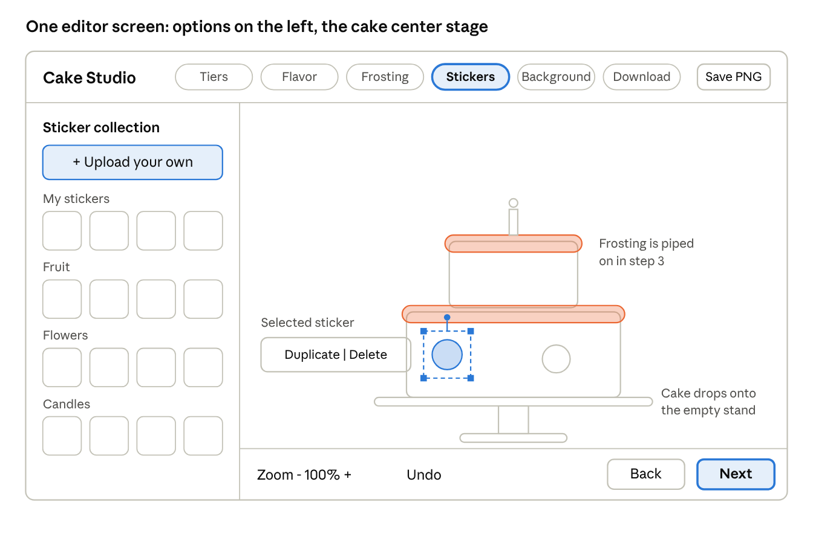

# Cake Builder Website: Design Doc

Nov 3, 2026 · key

Live version: https://claude.ai/artifact/JMRg2WqCpXHWMpDSJauYpM

## Overview

The site is a playful, step-by-step cake builder: a visitor picks tiers, picks a flavor, frosts it, decorates it with stickers, sets a background, and downloads the result as an image. This doc covers the design only; no code gets written until it is approved.

Goals:

- Each step feels tactile, with the cake reacting live (drops, color shifts, frosting being piped on).
- Decorating is free-form: any sticker, built-in or uploaded, can be placed, resized, rotated and duplicated.
- The finished cake can be saved as a clean image, with no editor controls in it.

Out of scope for v1 (unless wanted): ordering or payment, user accounts, saving designs to come back to later.

## User flow

Six steps, shown as a step bar across the top so people can jump back to any earlier step without losing work. Frosting comes before stickers so stickers sit on top of the buttercream; see open questions.

1. **Tiers.** The screen opens on an empty cake stand. The visitor picks 1, 2 or 3 tiers. The stand stays empty; faint dashed outlines preview how tall the cake will be.
2. **Cake flavor.** Three flavor cards: Red velvet, Chocolate, Vanilla.
   - Stand is empty: the cake (all chosen tiers) drops from above onto the stand, with a small bounce and a crumb puff.
   - Stand already has a cake: no drop. The sponge cross-fades to the new color in about 0.4 s.
   - Changing tier count later re-stacks the cake: a tier is added by dropping on top, or removed by lifting off.
3. **Buttercream.** Pick a frosting color (swatches, the right-side color wheel, or a color picked from an image) and a piping style: Swirl or Twist. Choosing a style plays the application animation; changing only the color recolors the existing frosting instantly.
4. **Stickers.** Left sidebar holds the sticker collection plus an Upload button. Stickers are dragged or tapped onto the cake, then moved, resized, rotated, duplicated or deleted.
5. **Background.** White by default, with a row of swatches and the color wheel. Applies to the stage behind the cake.
6. **Download.** Preview of the final image, then Download PNG. Editor handles and the sidebar are never part of the image.

Flavor to sponge color:

| Flavor | Sponge color | Notes |
| --- | --- | --- |
| Red velvet | Deep red | Thin white crumb layer between tiers |
| Chocolate | Brown | Darker brown filling line |
| Vanilla | White / cream | Pale yellow filling line so it reads against a white background |

## Screen layout

One editor screen serves all six steps: the step bar sits on top, the cake stays center stage, and only the left panel's contents change per step. A right-side color panel (not drawn yet) opens on the color steps.

What the left panel holds on each step:

| Step | Left panel |
| --- | --- |
| Tiers | Three big buttons: 1, 2, 3 tiers, each with a small cake silhouette |
| Flavor | Three flavor cards with a swatch of the sponge color |
| Frosting | Color swatches, then Swirl / Twist cards with a looping preview |
| Stickers | Upload button, My stickers, then the built-in groups (as drawn) |
| Background | Color swatches, White selected by default |
| Download | Final preview thumbnail and a Download PNG button |

On phones the left panel becomes a bottom drawer that slides up, and the step bar shrinks to numbered dots.

## Interactions and animation

Every animation is short (under 2 s) and skippable by clicking again, and all of them fall back to a simple fade when the visitor's system asks for reduced motion.

| Moment | What happens | Timing |
| --- | --- | --- |
| Cake drop (empty stand) | Tiers fall from above the stage, land with a squash-and-stretch bounce, crumbs puff out | about 0.7 s |
| Flavor change (cake present) | Sponge color cross-fades, a slight wobble so the change is noticed | about 0.4 s |
| Tier added / removed | New tier drops onto the top; removed tier lifts up and fades | about 0.5 s |
| Buttercream: Swirl | A piping bag traces a spiral across the top of each tier, frosting appears behind its tip, then drips settle down the sides | about 1.5 s per cake |
| Buttercream: Twist | Piping bag pipes a ring of twisted rosettes around each tier's top edge, one by one | about 1.5 s per cake |
| Frosting color only | Frosting recolors in place, no replay | instant |
| Sticker placed | Sticker pops in at 110 % and settles to 100 % | about 0.2 s |

Sticker editing:

- **Add:** drag from the sidebar onto the cake, or tap a sticker to drop it at the center.
- **Select:** click a sticker to show a box with corner handles, a rotate handle, and a small toolbar (Duplicate, Bring forward, Send back, Delete).
- **Resize:** drag a corner handle, scroll the mouse wheel, or pinch on touch. Size is kept between 20 % and 400 % of the original.
- **Duplicate:** creates a copy offset slightly down and right, already selected so it can be dragged away.
- **Keyboard:** arrows nudge, Delete removes, Ctrl/Cmd+D duplicates, Ctrl/Cmd+Z undoes.
- **Upload:** PNG, JPG, SVG or WebP up to 5 MB. Uploads join a "My stickers" group at the top of the sidebar for the session. A transparent PNG works best; v1 does not remove backgrounds automatically.
- **Stage zoom:** a separate zoom control (and Ctrl+scroll) zooms the whole view in for detail work without changing the cake itself.

Download exports the stage at 2x resolution (about 2000 px wide) as PNG, with the chosen background color and no selection boxes.

Color picking (right-side panel):

- **Color wheel:** a panel on the right side of the screen with a color wheel and a brightness slider. It opens on the Flavor, Frosting and Background steps and sets whichever color that step controls. The cake recolors live as the visitor drags around the wheel.
- **Pick from an image:** an "Upload image" button in the same panel shows the visitor's photo. They drag an eyedropper over it, a magnifier shows the pixel under it, and letting go sets that as the color.
- **Cake color:** choosing a flavor still sets its default color (red, brown, white), but a color from the wheel or an image overrides it while keeping the chosen flavor's name and texture.
- **Recent colors:** the last 8 colors used appear as swatches under the wheel so they can be reused for frosting or background.
- The panel collapses to a small color button when not in use, so the cake stays big on screen. On phones it opens as a drawer from the bottom.

## Suggested tech approach

A single-page React app where the cake is built from layered, photo-style images and the stickers sit on a canvas layer above it. It runs entirely in the browser, so there is no server to host beyond static files.

| Piece | Choice | Why |
| --- | --- | --- |
| App | React + Vite + TypeScript | Fast to build, easy step-by-step state |
| Cake drawing | Layered photo-style PNG images, one set per tier, tinted live | Looks realistic, and every color change shows instantly |
| Animations | Framer Motion for drops and pops; path-based reveal for the piping | Spring physics for the bounce; the piping follows a path so it looks hand-applied |
| Stickers | Konva (react-konva) with its Transformer | Built-in drag, resize, rotate handles and pinch support |
| Uploads | Read in the browser as image data, never sent anywhere | No storage or privacy concerns for v1 |
| Download | Konva's stage export to PNG at 2x | One call produces the clean image |
| State | One small store (Zustand): tiers, flavor, colors, frosting, stickers, background, plus undo history | Going back a step keeps everything |
| Hosting | Any static host (GitHub Pages, Netlify, Vercel) | Free tier is enough |

The sticker library ships as about 30 stickers in groups such as Fruit, Flowers, Candles, Sprinkles and Toppers. Custom art drops straight in.

**Live, realistic images.** The cake is built from layered, photo-style image pieces rather than flat drawings: a sponge layer per tier, a frosting layer per piping style, the stand, and a soft shadow. Each piece is a transparent PNG, and colors are applied live with a tint, so a flavor or frosting change shows on the cake instantly. The piping animation reveals the frosting image along the piping path. This needs a set of matching cake photos or rendered images, from stock art or a generated consistent set.

## Open questions before building

Assumed answer in brackets.

- [ ] Maximum tiers: 1 to 3, or more? [1 to 3]
- [ ] Step order: frosting before stickers? [Frosting first]
- [ ] Frosting per tier or one color for the whole cake? [One color and style for all tiers]
- [ ] Any piping styles besides Swirl and Twist, such as plain smooth or drips? [Only Swirl and Twist]
- [x] Visual style: realistic cake images that update live with every choice (decided)
- [ ] Color wheel for cake only, or also frosting and background? [All three]
- [ ] Sticker art: provided, or a drawn starter set? [Starter set of about 30]
- [ ] Should stickers be allowed outside the cake (on the stand or background)? [Yes, anywhere on the stage]
- [ ] Download format: PNG only, or also JPG? [PNG only]
- [ ] Phone support needed from day one, or desktop first? [Both, sidebar becomes a bottom drawer on phones]
- [ ] Site name and branding? [Placeholder name "Cake Studio"]
